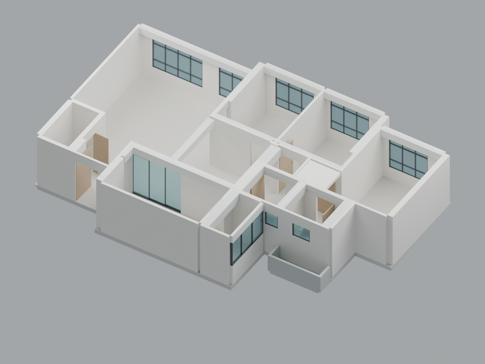

# 223C Interior Design

Editable Blender model of the existing home, built from the owner's measured floor plan and beam sketch. The first stage is an architectural shell for iterating on loose furniture.

**Current model:** [223C Existing Shell v02](model/223C_Existing_Shell_v02.blend), created with Blender 4.5. The initial [v01 model](model/223C_Existing_Shell_v01.blend) is also retained.

## Included

- Metric shell with a confirmed 2580 mm finished-floor-to-unfinished-ceiling datum.
- Existing concrete and internal walls, doors, windows, beams, and confirmed 150 mm ceiling drop.
- Separate collections for architecture and future loose furniture.
- Original [floor plan](Floor%20Plan.png) and [beam sketch](model/reference/Beam%20Plan.png), also packed into the Blender file.
- Rebuild source, editable assumptions, dimension checks, and rendered previews.

## Latest corrections

- Service yard: three-panel sliding window across the east wall above a 1000 mm-high solid wall.
- Maid room: door opens outward into the entrance area.
- Study and girls bedroom: hinge sides swapped, with doorway locations preserved.
- Master bedroom: upper hinge moved to the centre of the 145 mm segment between the 365 and 1405 dimensions; doorway crosses the passage toward the bathrooms.

## Review and edit

See [model instructions](model/README.md), [confirmed facts and assumptions](model/MODEL_NOTES.txt), and [editable settings](model/model_settings.json). Window heads, some door dimensions, unlabelled beam heights, finishes, and the bathroom floor-drop depth remain provisional.

The [saved-file geometry audit](model/geometry_audit.json) checks 15 principal room dimensions against the plan within a 5 mm raster tolerance. It also verifies the corrected window opening and door locations/swings. Further furniture layouts should be saved as separate design versions.

[Labelled floor plan](model/previews/02_floor_plan.png) · [Ceiling structure](model/previews/03_ceiling_structure.png) · [Service-yard window](model/previews/04_service_yard_window.png)

## Living-room design

The [iteration plan](design/living-room/PLAN.md) starts with a household interview, compares measured furniture layouts, and records accepted decisions before refining finishes and sourcing. The [living-room brief](design/living-room/BRIEF.md) separates existing architectural evidence from owner preferences still to be established.

The reusable [living-room-design skill](design/skills/living-room-design/SKILL.md) is also installed in the owner's personal Codex skills folder. Invoke it with `$living-room-design`. Keep project decisions in the brief; preserve the existing shell when creating design variants.

The [first coordinated room designs](design/living-room/iterations/01-family-room-triplets/REVIEW.md) are **superseded**: the owner confirmed 2000 mm Packout stacks and an existing girls' built-in wardrobe omitted from those layouts. Their images/models are retained as historical concepts. See the current [plan](design/living-room/PLAN.md) for correction requirements; the old proxy checks are not a current feasibility result.

[Revision 02](design/living-room/iterations/02-wardrobe-and-full-height-packout/REVIEW.md) includes the existing sliding wardrobe, full-height freestanding Packout composition, updated plans/renders and editable models. The girls' west metal-cupboard doors require the pull-out bed stored for full access; the proposed night route is at the bed foot.
